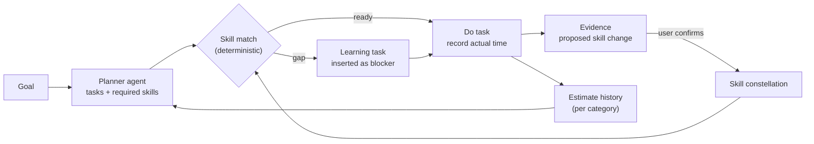
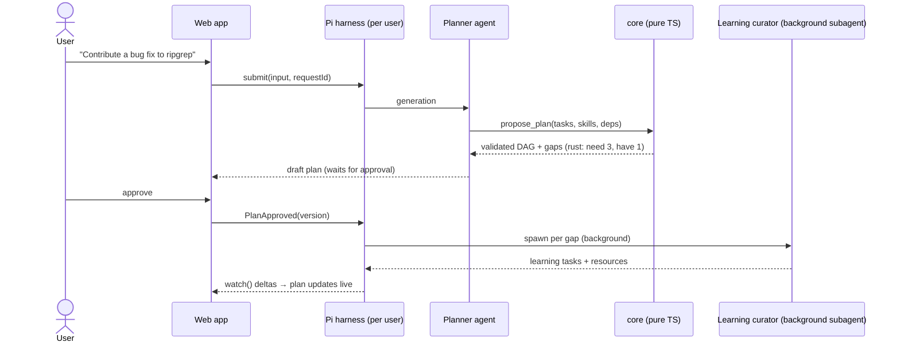
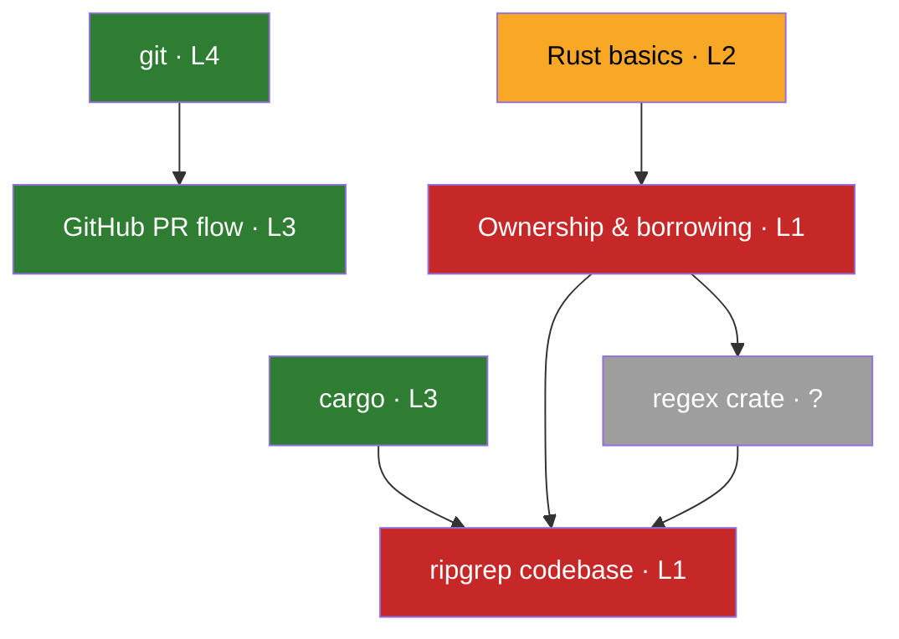
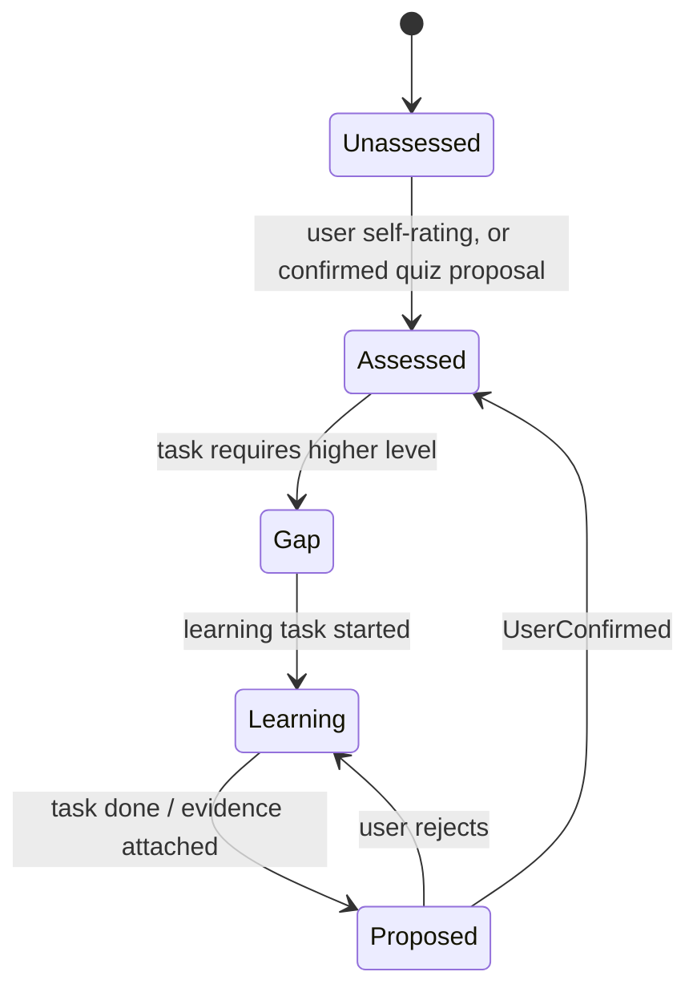
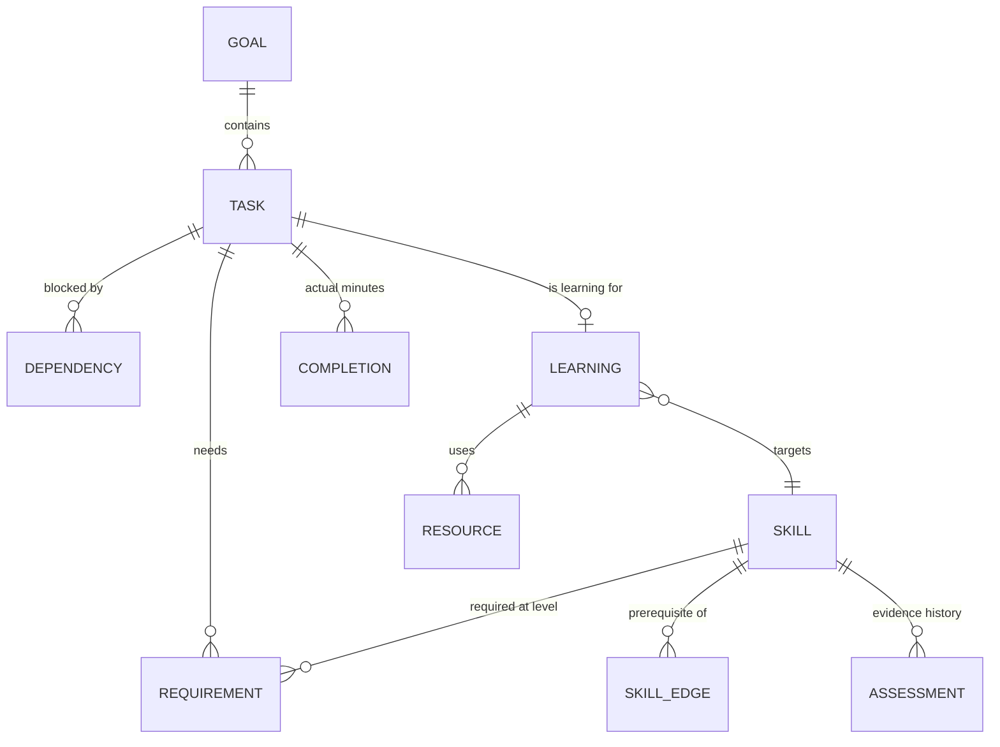
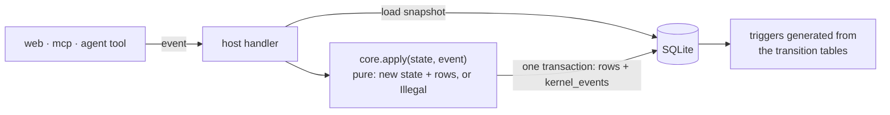
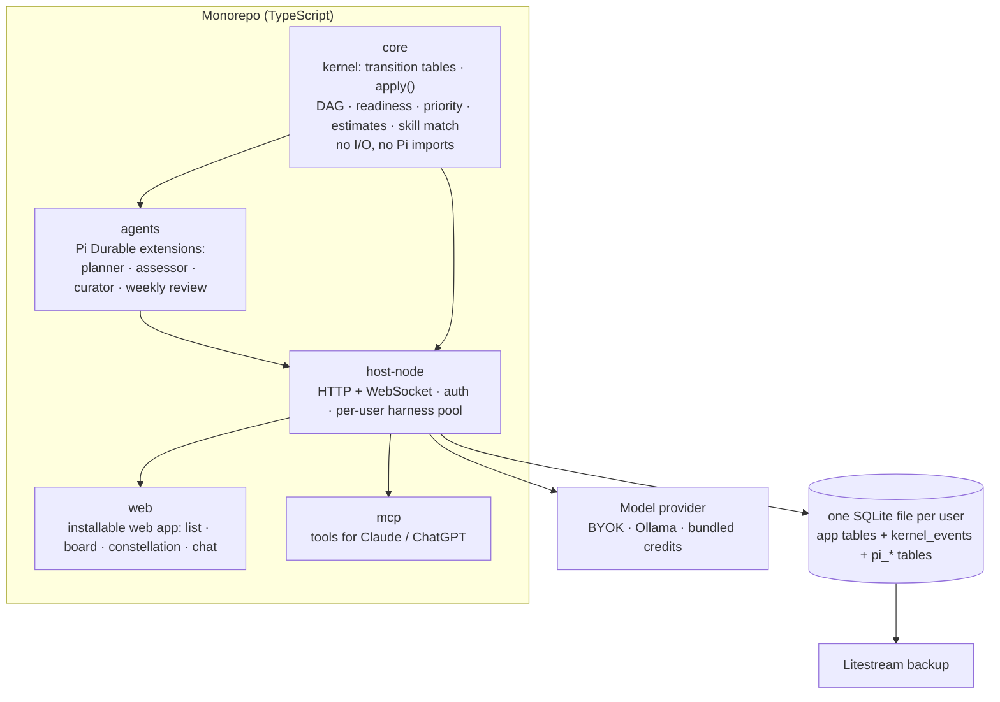
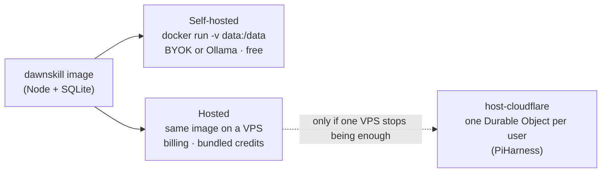
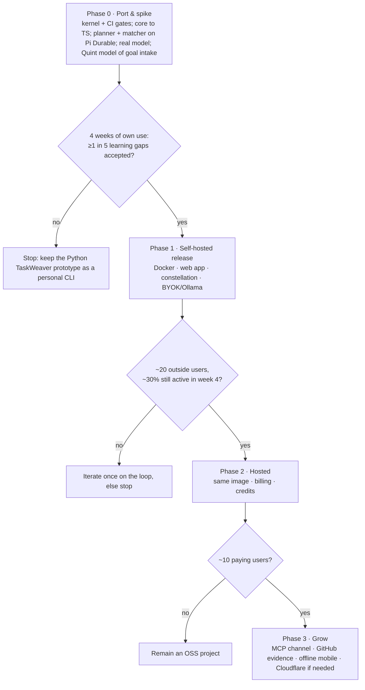

# Dawnskill: plan for a learning-first task system on Pi Durable

**Thesis.** Breaking goals into tasks is already a common AI feature (Todoist, TickTick, Tiimo, GoalOS). No catalogued product connects the skills a task requires with the learner's skill gaps, and then inserts learning as dependencies. Build that connection as a small AGPL app: free to self-host, with a cheap hosted option. Run it as one Node image on [Pi Durable](https://github.com/earendil-works/pi/tree/main/packages/durable).

**Target users.** Developers learning a new stack or contributing to open source. They self-host, pay for small tools, can use roadmap.sh as a skill vocabulary, and have checkable evidence on GitHub.

**Name.** Dawnskill: the first light of a new skill, as it appears in the constellation. The project succeeds the Python prototype [TaskWeaver](https://github.com/TheRockPusher/taskweaver), whose name collides with Microsoft's TaskWeaver agent framework. Checked 2026-10-15: `dawnskill.com`, `.app`, `.dev` and `.io` were unregistered, and npm `dawnskill`, GitHub `dawnskill` and PyPI `dawnskill` were free. Search found no product with the same name; the closest is the plural `dawnskills.com`, a bare school-portal page. Register the domains and claim the package/org names before announcing. Run a formal USPTO/EUIPO trademark search before launch.

## 1. Core loop

## 2. Goal intake (one durable run)

Agents only propose changes. `core` validates them: no cycles, valid levels, idempotent keys. The user approves every change to the plan or to a skill level. The kernel (§5) enforces this mechanically, not by convention.

## 3. Skill constellation

Example state, rendered as a graph view in the app:

Colors: green = level backed by evidence; amber = currently learning; red = gap that blocks a task; grey = not yet assessed.

The states below are a derived view, not stored columns. Only the level and its assessment history are stored, and only the kernel (§5) changes them. Unassessed = no assessment. Gap = a task requires a higher level than the current one. Learning = an open learning task targets the skill. Proposed = a level proposal is pending.

## 4. Domain model

These are app tables in the user's SQLite file. Pi's own tables are unprefixed by default (`conversations`, `entries`, `tasks`, `documents`, …), and `tasks` would collide with ours, so open Pi storage with `prefix: "pi_"` (added in Pi Durable 1.3.0). Pi documents hold only agent-side execution state. Domain state lives in app tables and changes only through the kernel.

## 5. Kernel: verified state machines

AI coding agents write most of the code. A small, human-owned kernel in `core` decides every change to domain state that carries an invariant. Mechanical gates (§8, §9) check that generated code conforms to it, so a reviewer reads kernel diffs, not all generated code.

| In the kernel | Why |
|---|---|
| Task `status` (open → doing → done / cancelled, reopen) | The prototype allowed any status to change to any other |
| Task completion (actual minutes, evidence) | Closing as done requires a completion row in the same step |
| Dependency edges (add / remove) | No cycles; no edges on closed tasks |
| Skill `level` and assessments | Level rises only with user confirmation |
| Proposals: `pending → accepted / rejected / superseded` | The only path from agent output to a state change |
| Plan version: `draft → approved → committed`, or `superseded` | Commit only the version the user approved |
| Learning-task link (task ↔ skill) | It is what makes a gap block a task |

**Derived, never stored:** `blocked` / `ready`, Gap, Learning, priority and estimates. They are pure functions in `core`, so they cannot drift into an illegal combination.

**Outside the kernel:** free text and metadata (titles, notes, resource links, tags) as plain validated updates; user preferences; Pi's own tables; auth and billing; frontend state. The web app may import the transition tables to show which actions are available, but the server decides.

- **Pure reducer.** Transition tables are `as const` data. `core.apply` switches exhaustively over event unions with no `default` branch, and returns either the new state with the rows to write or `Illegal`.
- **Provenance.** Every event carries its actor (`user`, `agent`, `system`). `UserConfirmed` and `PlanApproved` are branded types that only the host's authenticated handler can construct. Agent tools cannot produce them. A user's own self-rating is a user event; an assessor's quiz result is a proposal.
- **One writer.** `applyEvent` in `host-node` is the only code that writes kernel columns. In one transaction it writes the rows and appends to `kernel_events` (event, actor, resulting state hash).
- **Database backstop.** A migration generated from the transition tables creates `allowed_transitions` and `BEFORE UPDATE` triggers that `RAISE(ABORT)` on an illegal edge, on closing without a completion row, or on a level change without a confirmation row. CI regenerates it and fails on any diff. `CHECK` cannot do this because SQLite forbids subqueries in `CHECK`.
- **Agents propose only.** The planner, assessor, curator and weekly review create pending proposals and nothing else. The curator reads untrusted web content, so it has no other write path (Meta's "Rule of Two"). Invalid agent output is rejected with a repair message naming the bad value and the legal set; retries are counted in the run and capped.

Initial invariants, human-owned:

| ID | Invariant |
|---|---|
| K1 | A skill level changes only through a user event: a self-rating, or `UserConfirmed` referencing a pending proposal |
| K2 | A task closes as done only with a completion row written in the same transaction |
| K3 | A task cannot enter `doing` while it is derived-blocked (open dependency or skill gap) |
| K4 | The dependency graph stays acyclic; no edges are added to or from closed tasks |
| K5 | A plan version commits only if the approved version equals the draft version; superseded versions reject edits and cancel their in-flight curator work |
| K6 | Agent-sourced events only create or update pending proposals |
| K7 | Closing a task never deletes dependency edges, so reopening it restores blocking |
| K8 | Replaying `kernel_events` from empty reproduces the stored kernel state |

Phase 0 ends with a [Quint](https://github.com/quint-co/quint) model of goal intake and of K1, K5 and K6. These are the rules most exposed to races between approval, plan edits and background curator work. `quint verify` runs when the spec changes, and traces from `quint run --mbt` are replayed against `core.apply` in CI.

## 6. Architecture

## 7. Deployment: one image, two modes

## 8. Engineering stack

Versions are npm `latest` as of 2026-10-16; pin exact versions.

| Concern | Choice | Why |
|---|---|---|
| Runtime | Node 24 LTS, built-in `node:sqlite` | Pi Durable requires Node ≥22.19 and uses `node:sqlite`; no native build. `node:sqlite` is still release-candidate stability, so pin the Node major |
| Workspace | pnpm workspaces | Five packages; no Nx |
| Compiler | `typescript@7.0.2`, `tsc -b` with project references | `core` references nothing, so layering is a compile error. Flags: `strict`, `noUncheckedIndexedAccess`, `exactOptionalPropertyTypes`, `noImplicitOverride`, `noFallthroughCasesInSwitch`, `verbatimModuleSyntax`, `erasableSyntaxOnly` |
| I/O schemas | `typebox@1.3.x` | Pi's tool parameters already use TypeBox: one schema library. `core` uses plain discriminated unions |
| SQL | `node:sqlite` + hand-written versioned migrations, no ORM | Same pattern as Pi. Kysely has no `node:sqlite` dialect; Drizzle cannot generate triggers from the transition tables |
| Format | `@biomejs/biome@2.5.15`, format only | Biome's type-aware rules are still nursery |
| Type-aware lint | `oxlint@1.88.0` + `oxlint-tsgolint` | `no-floating-promises`; `switch-exhaustiveness-check` with `allowDefaultCaseForExhaustiveSwitch: false`. Override for `core`: ban `node:*`, `fs`, `net`, `http`, `child_process`, `@earendil-works/*`, `Date.now`, `Math.random` (clock and RNG are injected) |
| Architecture | `dependency-cruiser@18.6.0` | `core` depends on nothing outside `core`; no cycles |
| Structural bans | `@ast-grep/cli@0.51.0` | Bans raw `UPDATE … SET status/level` outside `applyEvent`; suppressions disallowed. The triggers catch dynamic SQL the rule cannot see |
| Dead code | `knip@6` | Agents leave unused exports and dependencies behind |
| Supply chain | `pnpm audit --prod --audit-level high`, `osv-scanner` v2.7 | |
| Git hooks | `lefthook@2` | Fast checks only; CI is the gate because hooks can be bypassed |
| Tests | `vitest@5.0.5`, `fast-check@4.10.2` + `@fast-check/vitest@0.5.0` | Property and model-based tests; `scheduledModelRun` for approval-vs-curator races |
| Mutation testing | `@stryker-mutator/core@10.0.0` + `@stryker-mutator/vitest-runner@10.0.0` | Measures whether tests catch kernel bugs; scoped to `core`, incremental in CI |
| Spec | `@informalsystems/quint@0.33.0` | Apalache (JVM) only for `quint verify`. A small hand-written ITF trace reader replays traces, unless `@firfi/quint-connect` supports the pinned Quint version |
| Agent tests | Pi's faux model provider | Scripted model responses; no live model in tests |

Rejected: typescript-eslint (its peer range is `typescript <6.1`, which excludes TS 7); XState (restoring a persisted snapshot does not reschedule `after` timers, [#5331](https://github.com/statelyai/xstate/issues/5331), and plain tables mirror a Quint spec directly); Temporal, DBOS and Restate (no production SQLite path, or a restrictive server licence).

### Testing: deterministic, no ceremony

Every test is deterministic by construction. Clock and RNG are injected into every entry point; `TZ=UTC`; fake timers drive all delays; no network and no live model. A faux-provider test fails if any scripted response is left unused or an unexpected model call happens. fast-check runs with a fixed seed in CI and fresh seeds nightly; a failing seed and path are committed as a replay case.

| Kind | What it proves | Scope |
|---|---|---|
| Compile-time | Every state and event is handled; agent code cannot construct `UserConfirmed` / `PlanApproved` | All packages |
| Model-based (fast-check `commands`) | Random event sequences keep K1–K8; rejected events leave state unchanged | `core` kernel |
| SQL invariant oracles | Queries that must return zero rows (done task without completion, edge on a closed task, level change without confirmation, cycle via recursive CTE), run after every step of the model-based tests against a real in-memory SQLite | Kernel + `applyEvent` |
| Trigger tests | Every pair of states not in the transition table is rejected by the database; generated from the table, not hand-written | Migrations |
| Replay | K8: replaying `kernel_events` reproduces stored state | Kernel + `applyEvent` |
| Agent scenarios | Scripted planner, assessor and curator responses yield only proposals; invalid output gets a bounded repair loop; normalized golden traces | `agents` |
| Host scenarios | Few end-to-end flows over HTTP with the faux provider: goal intake, approval required, plan superseded mid-fan-out | `host-node` |
| Quint | Spec-level safety rules hold; MBT traces replayed against `core.apply` | Goal intake, K1, K5, K6 |
| Mutation | Stryker score on the kernel is the measure of test strength | `core` kernel |

Not written: tests of wiring, getters, forwarding, mock echoes, UI markup snapshots, or Pi internals. No coverage threshold, because coverage targets reward exactly those tests; the mutation score replaces it.

Live-model quality (does the planner produce useful plans and gaps) is an eval run by hand against the Phase 0 gate, not part of the test suite.

## 9. Agentic development workflow

| Artifact | Author | Gate |
|---|---|---|
| Kernel: `packages/core/src/kernel/**`, `applyEvent`, trigger generator, invariant and model-based tests, Quint spec | Human | CODEOWNERS with required review; coding agents' tool hooks deny writes to these paths |
| Lint, architecture and ast-grep configs, CI, `CODEOWNERS` | Human | Same; GitHub applies the base branch's CODEOWNERS, so a PR cannot weaken it |
| Handlers, routes, Pi extensions, adapters, web UI, non-kernel migrations | Agents | CI required checks; human review of the diff |

Loop for a feature:

1. The human edits the machine, its invariants and seeded bad-transition cases. A gate that passes a seeded mutant is too weak.
2. Agents implement handlers and UI against the reducer's types.
3. CI runs, in order: `biome format --check`, `tsc -b`, `oxlint`, `depcruise`, `ast-grep scan`, `knip`, audits, tests, Stryker (incremental), Quint when the spec changed. Failures go back to the agent, which may not edit gate files.
4. The human reviews the kernel diff closely and the rest of the diff lightly.

Agent speedup is not assumed: one controlled study found Copilot 55.8% faster on a narrow new-code task, while METR found experienced developers 19% slower on mature open-source code. Track cycle time from Phase 0 and keep the kernel small enough to review every change.

## 10. Business model

| Tier | Price | Model access |
|---|---|---|
| Self-hosted (AGPL) | Free, unmetered | User's own key or Ollama (mid-size model or larger) |
| Hosted | ~€5/mo or €48/yr | Bundled flash-class credits; BYOK for frontier models |

Estimated variable cost per active hosted user per month:

| Item | Typical | Heavy (5×) |
|---|---|---|
| LLM, `glm-5.3-flash` | $0.14 | $0.70 |
| LLM, `kimi-k2.6` | $0.95 | $4.75 |
| Search for learning resources (if used) | ~$0.25 | ~$1.25 |
| Hosting (VPS or Durable Object) | ~$0.01 | ~$0.05 |

About 5–10 paying users cover the fixed infrastructure costs. Comparable prices: Vikunja Cloud €4, Readwise Lite $5.59, Mindgrasp $9.99, RemNote Pro AI $18.

## 11. Roadmap and gates

| Phase | Ships | Explicitly not |
|---|---|---|
| 0 | `core` kernel and CI gates, planner, skill matcher, CLI harness, Quint model of goal intake | UI, auth, sync |
| 1 | `host-node`, `web`, constellation view, Docker | billing, multi-device offline |
| 2 | Auth, Stripe, credit metering, backups | teams, Cloudflare |
| 3 | `mcp`, GitHub evidence import, offline mobile | — |

## 12. Risks

| Risk | Mitigation |
|---|---|
| Pi Durable is experimental (1.3.0; 1.1–1.3 shipped within October 2026, with breaking changes in minor releases) | Pin the exact version; all domain logic lives in `core`; Pi holds only execution state; agents stay thin |
| AI-generated code breaks domain rules | Kernel with generated triggers, CI gates, CODEOWNERS; reviewers read kernel diffs closely |
| Prompt injection through learning resources | The curator can only create pending proposals; the user approves every change |
| Inaccurate skill assessment | Only confirmed evidence moves levels; never inferred from task speed |
| Unbounded LLM cost on hosted | Credit cap per plan; BYOK for frontier models |
| Crowded goal-planner market | Developer niche; self-host community first; MCP as a distribution channel |
| Python → TS rewrite | Port mainly about 1.3k lines of TaskWeaver domain logic: the pure matcher, cycle check and estimate median. Do not port its write tools, which let the LLM set `status` directly; leave its TUI, GitHub sync and memory in the Python prototype |
| `node:sqlite` is release-candidate stability | Pin the Node major; Pi depends on it too |
| Gate overhead absorbs the agent speedup | Measure cycle time from Phase 0; keep the kernel small |
| Two ways to deploy | One Node image for both modes; Cloudflare stays optional |
