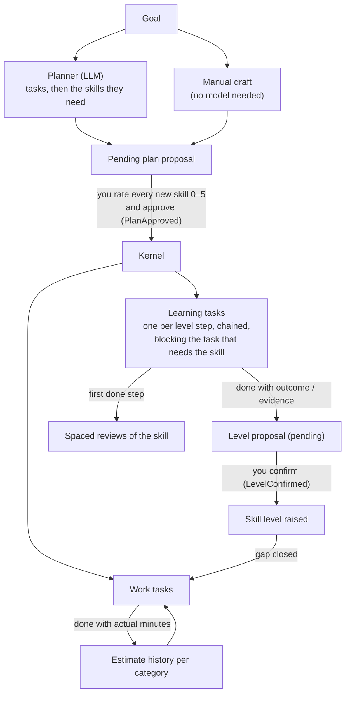

# Dawnskill

Dawnskill is a learning-first task manager for developers. You give it a goal and it plans the tasks. Each task names the skills it needs and the level it needs them at (Dreyfus levels 1–5). When your rated level is below what a task needs, Dawnskill adds learning tasks for the gap, one per level step, and they block the task until the gap is closed. A level changes only when you confirm it. Everything you learn stays in one skill inventory, so the next goal starts from what you already know.

Self-hosted, single user, one SQLite file. Licensed under AGPL-3.0.

## How it works



- The planner and the dedupe judge only produce proposals. A proposal changes nothing until you approve it ([architecture](docs/architecture.md#kernel)).
- A task is blocked while it has an open blocker or any skill gap. A skill nobody has rated counts as a gap. Finishing a learning task does not raise the level by itself: it creates a level proposal, and the gap stays open until you confirm it.
- For a task you add by hand, **Add learning steps** on its page creates the learning steps for its gaps. Plan approval uses the same generator.
- Ready tasks are ranked by a weighted score, and a learning task takes on the priority of the most important task waiting on it.

## Quick start

### Docker

```sh
docker run -p 127.0.0.1:3000:3000 -v dawnskill-data:/data ghcr.io/therockpusher/dawnskill:latest
```

Open http://127.0.0.1:3000. The app has no authentication, so keep the port bound to localhost unless something in front of it handles access. The image runs as a non-root user, stores data in the `/data` volume and has a health check on `GET /healthz`.

Then set the model under **Settings → Model** ([model configuration](#model-configuration)). Alternatively, [compose.yaml](compose.yaml), which builds the image locally, passes the `DAWNSKILL_LLM_*` variables through from your environment or a `.env` file:

```sh
DAWNSKILL_LLM_BASE_URL=http://host.docker.internal:11434/v1 DAWNSKILL_LLM_MODEL=qwen3:14b docker compose up -d
```

(`qwen3:14b` is only an example; use any model your server provides.) compose.yaml maps `host.docker.internal` to the host gateway, so a model server running on the host is reachable from the container.

### From source

Requires Node 24 (`.node-version`) and pnpm 12 (the exact version is pinned in `package.json` `packageManager`; `npm install -g pnpm@12.11.2`).

```sh
pnpm install
pnpm build    # Vite build of the web UI into packages/web/dist
pnpm start    # node packages/host/src/main.ts → http://127.0.0.1:3000
pnpm dev      # host with --watch on :3000 and the Vite dev server, which proxies /api and /healthz to it
```

The server runs its TypeScript directly through Node's type stripping, so there is no compile step. If `pnpm build` has not run, `pnpm start` still serves the API and returns a "Web UI not built" page.

| Variable | Default | Meaning |
|---|---|---|
| `PORT` | `3000` | HTTP port |
| `HOST` | `127.0.0.1` (`0.0.0.0` in the image) | Bind address |
| `DATA_DIR` | `./data` (`/data` in the image) | Directory of `dawnskill.db` and `llm-settings.json` |
| `WEB_DIR` | `packages/web/dist` | Built web UI to serve |

## Model configuration

The planner talks to any OpenAI-compatible `chat/completions` endpoint: llama.cpp `llama-server`, Ollama, vLLM or a hosted API.

Set the connection in the web UI under **Settings → Model**; no restart or environment variable is needed. **Service** offers presets for OpenCode Go and OpenRouter, which fill in the base URL and a suggested model, or **Custom URL** for any other server. The host stores the settings in `$DATA_DIR/llm-settings.json` (file mode 0600, API key in plain text) and never returns the key to the browser. To protect it, a saved key is reused only for the URL it was entered for: changing the base URL, including switching presets, requires entering the key again. Settings saved in the app take precedence over the variables below. **Remove saved settings** deletes the file, and the variables apply again.

The same connection can come from environment variables instead:

| Variable | Default | Meaning |
|---|---|---|
| `DAWNSKILL_LLM_BASE_URL` | unset: no model unless one is set in the app | API root including the version segment, e.g. `http://127.0.0.1:8080/v1` (llama.cpp), `http://host.docker.internal:11434/v1` (Ollama on the Docker host) |
| `DAWNSKILL_LLM_API_KEY` | none | Sent as `Authorization: Bearer …`; redacted from error messages |
| `DAWNSKILL_LLM_MODEL` | `default` | `model` field of each request |
| `DAWNSKILL_LLM_TIMEOUT_MS` | `120000` | Per-request timeout |
| `DAWNSKILL_LLM_MAX_TOKENS` | `4096` | Upper bound on `max_tokens` for every request. Size it to your model's context window |

`DAWNSKILL_LLM_TIMEOUT_MS` and `DAWNSKILL_LLM_MAX_TOKENS` also apply to a model set in the app.

The server must support structured outputs. Every request sends `response_format: { type: "json_schema", json_schema: { strict: true, … } }`, and the planner depends on that constrained decoding. If a server reports that the context is exceeded, the run fails at once with a clear error. If a reply is cut off at `max_tokens`, the planner retries with a request for a shorter answer.

Every request also carries `User-Agent: dawnskill/<version>` and an `x-opencode-session` ID that is fixed for one plan run and new for the next. OpenCode Go needs the session header; other servers ignore it.

### Hosted services

Both presets were verified on 16 October 2026 with full planner runs at the default limits.

| Service | Base URL | Suggested model | Result | API key |
|---|---|---|---|---|
| [OpenCode Go](https://opencode.ai/docs/go) | `https://opencode.ai/inference/go/openai/v1` | `longcat-2.0` | planned in 69–83 s, no repairs | [OpenCode console](https://opencode.ai/console) |
| [OpenRouter](https://openrouter.ai) | `https://openrouter.ai/api/v1` | `anthropic/claude-haiku-5.5` | planned in 23 s, no repairs | [openrouter.ai/keys](https://openrouter.ai/keys) |

Through OpenRouter, `openai/gpt-6.1-sol` also planned without repairs, and `deepseek/deepseek-v4.1-flash` needed two. Choose models whose supported parameters include structured outputs.

The Anthropic and OpenAI APIs have no preset. Anthropic's OpenAI-compatible endpoint ignores `response_format` and rejects `temperature` below 1 on current Claude models. Current GPT models do not accept `temperature` either. Use them through OpenRouter.

#### OpenCode Go models

Go's models reason before they answer, and those tokens count against `max_tokens`. In one of five `longcat-2.0` test runs, a request passed the 120 s default timeout. If runs time out or are cut off, set `DAWNSKILL_LLM_TIMEOUT_MS=300000` and `DAWNSKILL_LLM_MAX_TOKENS=8192`.

Results from 16 October 2026, using one planner run per model at `DAWNSKILL_LLM_MAX_TOKENS=8192`:

- Planned without a repair: `longcat-2.0`, `kimi-k3`, `mimo-v2.6-pro`, `step-5-preview`, `glm-5.3-flash`.
- `glm-5.2` needed one repair.
- Failed:
  - `deepseek-v4-pro` rejects `json_schema`. `deepseek-v4.1-flash` rejects it in about 40% of sessions.
  - `kimi-k2.7-code` accepts only `temperature: 1`.
  - `space-bunny` rejects the request.
  - `hy4-preview` runs out of tokens.

Models that Go serves through its Anthropic or Responses endpoints, such as Claude, GPT, Grok, Qwen and MiniMax, do not work here.

Without a model, everything except the planner still works. `POST /api/plan` returns 503, and on the Plan page you write the draft yourself with **Write a draft manually**. It then goes through the same rating, approval and learning-step generation.

## The numbers and where they come from

Every constant is specified, with its sources and limits, in [docs/learning-model.md](docs/learning-model.md). The kernel and analytics in `packages/core` implement that document.

| Rule | Value in code | Specification |
|---|---|---|
| Skill levels | Dreyfus 1 Novice … 5 Expert, plus 0 "no exposure" for self-rating only. You rate yourself against behavioural anchors ("I can plan and deliver a non-trivial feature on my own…"), not adjectives | [§1](docs/learning-model.md#1-skill-levels-dreyfus-15-plus-product-level-0) |
| Learning steps | A gap of k levels becomes k chained learning tasks, one per level step. `practiceMinutes` is the planner's estimate per step (kernel range 5..2400; the planner aims for at most 480) | [§2](docs/learning-model.md#2-skill-granularity) |
| Activity per step | Chosen by target level (expertise reversal): L1 worked examples, L2 guided practice, L3 independent project, L4 varied real cases, L5 teach and extend | [§3](docs/learning-model.md#3-learning-activity-per-target-level), [§4](docs/learning-model.md#4-just-in-time-learning-tied-to-an-application) |
| Spaced review | SM-2 with two grades and ease 2.5: 1, 6, 15, 38, 95 … days. Forgetting resets the interval to 1 day | [§5](docs/learning-model.md#5-retrieval-practice-and-spaced-review) |
| Priority | Simple additive weighting of importance, urgency, unblocks, effort (log scale) and age. Rank-Order Centroid weights by default 137/300, 77/300, 47/300, 27/300, 12/300. A blocker inherits the priority of the task it blocks | [§6](docs/learning-model.md#6-priority-weighted-sum-saw-with-roc-weights) |
| Estimates | Reference class per category: once 3 or more done tasks have tracked time, a raw estimate is multiplied by the median actual/estimate ratio. The sample count and MAD are shown with it | [§7](docs/learning-model.md#7-duration-estimates-reference-class-outside-view) |

## UI tour

- **Focus**: what to do now. Next ready work and next learning steps, ranked by effective score, plus "Needs you": pending drafts, level confirmations and due reviews.
- **Plan**: start a planner run or write a draft by hand, review and edit drafts, rate new skills, preview the learning steps approval will add, then approve or reject.
- **Tasks**: filterable list and task pages with the priority breakdown, why the task is blocked, dependencies, learning-step details, completion history, and the start, pause, complete, cancel and reopen actions.
- **Skills**: the skill constellation (prerequisite graph) and skill pages with levels, assessment history, self-rating, level proposals, retrieval prompts and resources.
- **Learning**: due reviews (recalled or forgot), level confirmations, the review schedule, skill progress and a journal of everything learned, assessed, reviewed and completed.
- **Settings**: model connection (base URL, model, API key), ranking of the priority criteria and the resulting weights, estimate statistics per category, and data export.

## Data and privacy

- All state lives in one SQLite file, `$DATA_DIR/dawnskill.db`, in WAL mode, so `-wal` and `-shm` files sit next to it. Back up the directory.
- The append-only `kernel_events` table is the source of truth. The other tables are a projection of it. On every start the app replays the log and checks the result against the stored state hash, and it refuses to start if they differ.
- `GET /api/export` (Settings → Export everything) downloads every event as JSON: the complete, replayable history. Model settings and the API key are not events, so exports never contain them.
- Anyone who can reach the port can change the model settings, though not read the saved key: another reason to keep the port bound to localhost.
- The server makes outbound requests only to the configured model endpoint. Those requests contain your goal and context, the names of your existing task categories and the planned task titles. When deduplicating skills, they also contain the key, name, description and concepts of existing skills.

## Development

```sh
pnpm check   # format:check → typecheck → triggers:check → lint → knip → test → build
```

| Command | What it does |
|---|---|
| `pnpm format` / `pnpm format:check` | Biome, formatting only |
| `pnpm typecheck` | `tsc -b` over the project references |
| `pnpm triggers:gen` / `pnpm triggers:check` | Regenerate / verify `packages/host/src/db/generated-triggers.sql` from the kernel transition tables |
| `pnpm lint` | oxlint with type-aware rules and import bans |
| `pnpm knip` | Unused files, exports and dependencies |
| `pnpm test` | Vitest across all packages, `TZ=UTC` |
| `pnpm mutation` | Stryker on `packages/core` (weekly in CI) |
| `pnpm perf` | Performance measurements on synthetic data (run `pnpm build` first). `pnpm perf --check` fails when a budget is exceeded. Results: [docs/performance.md](docs/performance.md) |

Tests are deterministic: the clock is injected, `TZ=UTC`, and fast-check runs with a fixed seed (`FC_SEED`, default 424242) in CI and fresh seeds nightly. They cover model-based kernel properties, SQL invariant oracles against a real SQLite, trigger tests generated from the transition tables, event-log replay, planner runs against a scripted model provider, and end-to-end HTTP scenarios. CI also builds the Docker image and smoke-tests it with `scripts/docker-smoke.sh`. See [docs/architecture.md](docs/architecture.md#testing-strategy) and [CONTRIBUTING.md](CONTRIBUTING.md).

## License

[AGPL-3.0](LICENSE).
