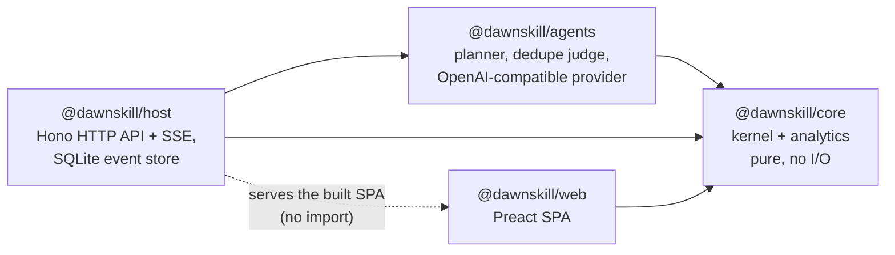

# Architecture

This document describes the code as it is. [PLAN.md](../PLAN.md) holds the original design, and the [last section](#deviations-from-planmd) lists where the code departs from it. Learning-science constants are specified in [learning-model.md](learning-model.md).

## Packages

Arrows point from a package to the packages it imports. The direction is enforced three ways:

- **TypeScript project references.** `packages/core/tsconfig.json` references nothing, `agents` and `web` reference only `core`, and `host` references `core` and `agents`. An import against that direction fails `tsc -b`.
- **oxlint import bans** (`.oxlintrc.json`):
  - `core` may not import `node:*`, `fs`, `net`, `http`, `child_process`, `@earendil-works/*` or any other `@dawnskill/*` package, and may not call `Date.now`, `performance.now`, `Math.random`, `crypto.randomUUID` or `crypto.getRandomValues`. The clock and ids are injected.
  - `node:sqlite` is banned everywhere except `packages/host/src/db/**`.
  - `@dawnskill/core/user` is banned in `agents` and `web`.
- **Runtime layout.** Node runs the server's `.ts` files directly through type stripping. The web package is built by Vite, and the host serves `packages/web/dist` as static files with an SPA fallback.

The web app imports `core` for its types and for the pure helpers it shares with the server: `canTaskTransition`, `validateDraft`, `planLearning` for the approval preview, `rocWeights`, `ACTIVITY_GUIDE` and `LEVEL_NAMES`. The server still makes every decision.

## Kernel

`packages/core/src/kernel/` is the human-owned part (see CODEOWNERS). Every state change goes through `apply(state, event)`.

### Transition tables

`transitions.ts` holds the lifecycles as `as const` data:

| Machine | Transition | From | To |
|---|---|---|---|
| Task | `TaskStarted` | open | doing |
| | `TaskPaused` | doing | open |
| | `TaskCompleted` | open, doing | done |
| | `TaskCancelled` | open, doing | cancelled |
| | `TaskReopened` | done, cancelled | open |
| Proposal | `PlanApproved`, `LevelConfirmed` | pending | accepted |
| | `ProposalRejected` | pending | rejected |
| | `Superseded` | pending | superseded |

The reducer, the generated SQLite triggers, the trigger tests and the web UI (which uses it to decide which buttons to show) all read these tables. `TASK_STATUS_EDGES` and `PROPOSAL_STATUS_EDGES` are the distinct (from, to) pairs.

### Pure reducer

`apply(state, event)` returns `{ ok: true, state }` or `{ ok: false, code, message }`, where `code` is one of `not-found`, `illegal-transition`, `blocked`, `cycle`, `closed-task-edge`, `actor`, `invalid` or `duplicate`. The message names the bad value and the legal set. On `Illegal` the caller keeps the old state.

- `reduce` switches over every event type with no `default` branch. oxlint's `switch-exhaustiveness-check` with `allowDefaultCaseForExhaustiveSwitch: false` makes a missing case a lint error.
- Ids (`G<n>`, `T<n>`, `P<n>`) come from one counter, `state.nextId`, and time comes from `event.at`. Same log in, same state out.
- Unchanged entities keep their object identity. Persistence relies on this: it diffs by identity.
- `readiness.ts` derives `blocked`/`ready`: a task is blocked while it has an open blocker or any skill gap, and an unrated skill counts as a gap. Gaps, priority, estimates and review schedules are computed and never stored.
- `learning.ts` (`planLearning`) turns gaps into learning chains. Each skill gets one task per level step, from the current level + 1 up to the highest level any consumer needs, and each step blocks the next. A skill's first open step waits on the last open step of each of its prerequisites. Each consumer waits on the step that reaches its own required level. Existing non-cancelled steps are reused, so running it again adds nothing. It runs on `PlanApproved` and on `LearningStepsAdded`.
- `validate.ts` checks drafts, new tasks, task patches and new skills: field ranges, references, acyclic prerequisites and the skill-key pattern.

### Events and actors

`EventBody` (`events.ts`) is the union of every event type. Each carries an envelope `{ at, actor }`, where `actor` is `user`, `agent` or `system`.

| Group | Events |
|---|---|
| Tasks | `TaskCreated`, `TaskEdited`, `TaskStarted`, `TaskPaused`, `TaskCompleted`, `TaskCancelled`, `TaskReopened` |
| Dependencies | `DependencyAdded`, `DependencyRemoved`, `LearningStepsAdded` |
| Skills | `SkillCreated`, `SkillSelfRated`, `ReviewRecorded` |
| Proposals | `PlanProposed`, `LevelProposed`, `ProposalRejected`, `PlanApproved`, `LevelConfirmed` |
| Preferences | `PreferencesSet` |

`apply` checks the actor at runtime (`actorDenied`). `agent` may emit only `AGENT_EVENTS` (`PlanProposed`, `LevelProposed`). `system` may emit nothing; system-authored records exist only inside a user event. For example, completing a learning task creates a pending level proposal with actor `system` in the same step. The host posts planner output as `PlanProposed` with actor `agent` (`host/src/runs.ts`). The HTTP events route posts everything as `user`.

### Branded user confirmations

`PlanApproved` and `LevelConfirmed` (`USER_CONFIRMATIONS`) only type-check inside a `KernelEvent` when they carry the phantom `UserConfirmed` brand. The only function that applies the brand is `userEvent` in `@dawnskill/core/user`. In the app, only the host's events handler (`host/src/api.ts`) imports that module; the store's replay casts stored events, which were legal when applied. oxlint bans the import in `agents` and `web`. Agent code therefore cannot construct an approval without failing typecheck or lint. The runtime actor check is the second layer.

### Invariants

| ID | Invariant | Reducer | Generated triggers | Tests |
|---|---|---|---|---|
| K1 | A skill level changes only through a user event: a self-rating (`SkillSelfRated`, or ratings in `PlanApproved`) or `LevelConfirmed` of a pending proposal | `skillSelfRated`, `planApproved`, `levelConfirmed`; `actorDenied` | `skill_insert_unrated`, `skill_level_needs_assessment` (the level must equal the latest assessment row) | model-based `checkLevels`; trigger tests; oracle `levelDiffersFromLatestAssessment` |
| K2 | A task closes only with a completion row written in the same step (done *and* cancelled) | `taskCompleted`, `taskCancelled` | `task_close_needs_completion`, `task_status_transition` | `checkCompletions`; trigger tests; oracle `closedWithoutMatchingCompletion` |
| K3 | A derived-blocked task (open blocker or skill gap) cannot enter `doing` | `taskStarted` → `isBlocked` | none (blocked is derived, not stored) | `checkGraph`; HTTP and Docker smoke: starting a blocked task returns 409 |
| K4 | The dependency graph stays acyclic; no edge is added to or removed from a closed task | `dependencyAdded` (`wouldCycle`, `closedEdgeEnd`), `dependencyRemoved`, `planLearning` | `dependency_insert_open_tasks`, `dependency_delete_open_tasks` (closed tasks only; acyclicity is not a trigger) | `checkGraph`; learning properties; oracle `dependencyCycle` |
| K5 | Only a pending plan commits, re-validated against the current state; a superseded or rejected plan never commits | `planApproved`, `planProposed` (`supersedes`) | `proposal_status_transition` | `checkProposals`; oracle `acceptedWithoutPending`; host scenarios "plan superseded" |
| K6 | Agent events only create pending proposals | `actorDenied` + `AGENT_EVENTS`; `UserConfirmed` brand | none | `checkProposals`; host scenario "agent output only ever becomes a pending proposal" |
| K7 | Closing a task never deletes its edges, so reopening restores blocking | status changes leave `blockers` untouched | `dependency_delete_open_tasks` | `checkGraph`; trigger and store tests |
| K8 | Replaying `kernel_events` from empty reproduces the stored state | determinism of `apply` | — | store property "close and reopen…"; tampered-hash test |

## Persistence

`packages/host/src/db/` (also human-owned) holds the only code that opens SQLite.

- **The event log is the source of truth.** `kernel_events(seq, at, actor, type, body, state_hash)` is append-only, and `state_hash` is the sha256 of the canonical JSON of the state after that event.
- **One writer.** `Store.apply` runs `core.apply`. If the result is legal, a single `BEGIN IMMEDIATE` transaction writes the changed projection rows and the event row. Only after the commit does it update the in-memory state and notify subscribers (SSE). A rejected event writes nothing.
- **Projection tables:** `proposals`, `goals`, `skills`, `skill_prerequisites`, `assessments`, `tasks`, `task_requirements`, `dependencies`, `completions`, `reviews`, `preferences`, plus `allowed_transitions`. `projectionWriter` writes only the entities whose reference changed, in an order that keeps foreign keys and triggers satisfied. The app never reads the projection back: it exists for the triggers, the oracles and external SQL inspection.
- **Replay on open.** `openStore` replays the whole log through `core.apply`. It fails if an event is now illegal, if a sequence number disagrees, or if the final state hash differs from the stored one ("the log or the kernel changed").
- **Migrations.** These are append-only SQL strings, tracked by `PRAGMA user_version`. A database newer than the build is refused. Connections run with WAL, `synchronous = NORMAL`, `foreign_keys = ON` and `busy_timeout = 5000`.
- **Generated triggers.** `triggers.ts` (`generateTriggerSql`) builds `generated-triggers.sql` from `TASK_STATUS_EDGES` and `PROPOSAL_STATUS_EDGES`: it fills `allowed_transitions` and creates `BEFORE` triggers that `RAISE(ABORT)`. A `CHECK` constraint cannot do this because SQLite forbids subqueries in `CHECK`. The file is committed. `pnpm triggers:gen` rewrites it, and `pnpm triggers:check` (part of `pnpm check` and CI) prints a line diff and exits 1 on drift. Every database open drops and reinstalls the triggers, so an existing database picks up changed tables.

## Planner

`packages/agents` turns a goal into a `PlanDraft` (`planGoal`) through the `ChatProvider` interface (`completeJson(request, signal) → raw JSON text`).

1. **Stage A, tasks** (`plan_tasks` schema). The model writes a summary and 1–12 tasks. `after` holds 0-based indices of earlier tasks. Normalization rounds minutes and drops forward, self and out-of-range indices, so the dependencies always form a DAG. The goal text is the user's, trimmed and cut to 200 characters; the model never rewrites it.
2. **Stage B, skills** (`plan_skills` schema, built per request by `skillsSchema(taskCount)`). The model lists skills with `neededBy: [{ task, level }]`. `task` is an `enum` of the actual task indices and `level` an `enum` of 1–5, so constrained decoding cannot produce a dangling reference. `requires` is derived from `neededBy`, taking the highest level per task and skill. An entry whose key exactly matches a known skill reuses that skill. Unknown prerequisite keys are dropped.
3. **Validation and bounded repair.** Each stage's output is normalized (keys slugified, strings trimmed, duplicates and non-http(s) resources dropped), checked against its JSON Schema and against core `validateDraft`, and then either accepted or answered with a repair turn. The repair turn quotes the output and numbers every error. Each stage gets at most `maxRepairs` repairs (default 2). After that `PlannerError` carries the errors and the attempt count.
4. **Truncation retry.** A reply ending with `finish_reason: "length"` raises `TruncatedReplyError`. The stage then sends the original request again with a note asking for at most 8 items and one sentence per field; this uses the same repair budget. A context-size error from the server (`ContextSizeError`) is fatal and not retried.
5. **Dedupe judge.** For each new draft skill, existing skills whose key+name token Jaccard is ≥ 0.5 are candidates, judged best match first, with at most 8 judge calls per plan. Each judge call asks for `{"same": boolean}` (schema `same_skill`). Anything other than an explicit `true` keeps the new skill. A merge is applied only if the draft stays valid.

`openAiCompatibleProvider` POSTs to `<base>/chat/completions` with `temperature: 0.2`, `max_tokens = min(request, DAWNSKILL_LLM_MAX_TOKENS)` (stages ask for 8192) and `response_format.type = "json_schema"` with `strict: true`. It applies a timeout (`DAWNSKILL_LLM_TIMEOUT_MS`) and redacts the API key from errors.

The host runs one planner run at a time in the background (`runs.ts`). The run's result becomes a `PlanProposed` event with actor `agent`. Run records (`R<n>`, the last 20) are kept in memory and published over SSE. Shutdown aborts a run that is still in flight.

The model connection lives in `host/src/llm.ts` (`createLlm`). Settings saved from the web UI (`PUT /api/settings/llm`) are written atomically to `$DATA_DIR/llm-settings.json` with mode 0600 and take precedence over the `DAWNSKILL_LLM_*` environment; `DAWNSKILL_LLM_TIMEOUT_MS` and `DAWNSKILL_LLM_MAX_TOKENS` apply to both. They are not events, so the key never enters the log or an export. Each plan run connects a new provider from the current settings, so a saved change applies to the next run, and a run already in flight keeps the provider it started with. A provider is one conversation: all its requests carry the same `x-opencode-session` ID, which OpenCode Go requires for routing and prompt caching. A saved key is reused only for the URL it was entered for, so changing `baseUrl` without a new `apiKey` is refused: whoever can reach the API cannot redirect the key to a server of their choosing. An unreadable settings file stops startup with its path.

## HTTP API

Routes are mounted by `createApp` (`host/src/server.ts`) and `createApi` (`host/src/api.ts`). Request bodies are limited to 1 MiB (413 `{ error }` when larger). Unknown `/api/*` paths return 404 `{ "error": "not_found" }`. An unhandled error returns 500 `{ "error": "internal error" }`.

| Method & path | Request | Success | Errors |
|---|---|---|---|
| `GET /healthz` | — | 200 `{ ok: true, version }` | — |
| `GET /api/view` | optional `If-None-Match` | 200 `View`, `ETag: "<seq>-<ms>"`, `Cache-Control: no-cache`; 304 when the ETag matches | — |
| `POST /api/events` | `EventBody` JSON (`{ "type": "TaskStarted", "taskId": "T3" }`) | 200 `{ seq }` | 400 `{ error, details[] }` (malformed JSON, unknown type, schema violation; details are JSON-pointer messages); 409 `{ code, message }` (kernel `Illegal`) |
| `POST /api/plan` | `{ goal (1–500 chars), context? (≤ 4000), supersedes? }` | 202 `{ runId }` | 400 `{ error, details[] }`; 409 `{ code: "invalid" }` if `supersedes` is not a pending plan; 409 `{ code: "busy" }` while a run is in progress; 503 `{ error }` without a model |
| `GET /api/plan/runs` | — | 200 `PlanRun[]`, newest first | — |
| `GET /api/stream` | — | Server-sent events: `change` `{ seq }` (sent once on connect and after every committed event), `run` `PlanRun` on every run status change; a `: ping` comment every 25 s | — |
| `GET /api/export` | — | 200 `{ format: "dawnskill-events", version, exportedAt, events: [{ seq, at, actor, body, stateHash }] }`, as an attachment | — |
| `GET /api/config` | — | 200 `{ version, llm: LlmStatus }` | — |
| `PUT /api/settings/llm` | `{ baseUrl (http(s) URL), model? (blank: "default"), apiKey? }`; `apiKey` omitted keeps the saved key, null or blank removes it | 200 `{ llm: LlmStatus }` | 400 `{ error, details[] }` (schema violation, URL not http(s), `apiKey` missing while `baseUrl` changes away from a saved key) |
| `DELETE /api/settings/llm` | — | 200 `{ llm: LlmStatus }`; the environment's configuration, if any, applies again | — |
| `GET /*` | — | static files from `WEB_DIR`, otherwise `index.html` (SPA fallback) | 404 text when the UI is not built |

`View` (`core/src/analytics/view.ts`) is `{ seq, now, criteriaRank, weights, goals, tasks, skills, proposals, focus, journal, reviews, categories }`. `deriveView(state, now)` computes it. The API caches it per `seq` and recomputes after 60 s even without new events, so ages and due reviews move forward with time.

`PlanRun` is `{ id, goal, status: "running" | "done" | "failed", attempts, error, errors[], proposalId, startedAt, finishedAt }`.

`LlmStatus` is `{ configured, source: "app" | "env" | null, model, baseUrl, hasApiKey }`. It never contains the key, and `baseUrl` is set only for settings saved in the app.

Request bodies are checked with TypeBox (`host/src/schemas.ts`): one closed schema per event variant, with structural size caps only. Every semantic rule stays in the kernel.

## Testing strategy

All tests run under Vitest (`pnpm test`, one project per package) and are deterministic:

- Clocks are injected (the core never reads time) and `TZ=UTC`.
- There is no network and no live model.
- fast-check uses a global seed from `FC_SEED` (default 424242) and `FC_NUM_RUNS` (default 200) set in `test/setup.ts`.

| Kind | What it proves | Where |
|---|---|---|
| Model-based properties | Random sequences of 10–40 events, user and forged agent/system ones, keep K1–K7, and illegal events are rejected | `core/src/kernel/apply.test.ts` |
| Kernel properties | Learning chains (one step per level, reuse, idempotence, no cycles, no edges on closed tasks); draft validation rejects every listed violation; ROC weights, scores, estimates, review intervals | `learning.test.ts`, `validate.test.ts`, `analytics.test.ts` |
| SQL invariant oracles | After every step of random store scenarios, queries that must return zero rows do (closed task without a matching completion, dangling edge, level ≠ latest assessment, cycle via recursive CTE, accepted without a pending decision), and the projection mirrors the state | `host/src/db/store.test.ts` |
| Trigger tests | Every status pair is accepted by the database exactly when it is in the transition table. The cases are generated from the tables, plus the completion, assessment and closed-edge rules and raw SQL that bypasses the kernel | `store.test.ts` |
| Replay (K8) | Close and reopen reproduces a deep-equal state with matching hashes; a tampered log is refused | `store.test.ts` |
| Scripted provider | Planner stages, repairs, truncation retry, context errors, normalization and skill reuse, run against `scriptedProvider`, which fails on an unexpected call and whose `assertDone()` fails if a reply was left unused | `agents/src/planner.test.ts`, `agents/src/testing.ts` |
| Host scenarios | HTTP flows over `createApp` with an in-memory store and the scripted provider: goal intake, approval required, plan superseded, one run at a time, 400/409 shapes, planner failure, ETag caching, no model, model settings (planning enabled without environment, persistence and precedence over the environment, key kept only for its URL) | `host/src/api.test.ts` |
| Nightly seeds | Daily run with `FC_SEED` = the workflow run id and `FC_NUM_RUNS=2000`. The seed and a replay command are printed to the job summary | `.github/workflows/nightly.yml` |
| Mutation testing | Weekly Stryker run over `packages/core/src` (incremental; report uploaded as an artifact). Baseline 2026-10-16: 70.7% overall (validate 85%, mcda 80%, learning 77%, apply 72%, view 36%). `vitest.mutation.config.ts` rewrites the runner's test-name filter for vitest 5's `" > "` separator; without it every mutant runs zero tests and "survives" | `stryker.config.json`, `vitest.mutation.config.ts`, `pnpm mutation` |
| Docker smoke | Built image: health, SPA, the offline plan → approve → learning-steps flow, the blocked start returning 409, persistence across a restart, export, non-root user | `scripts/docker-smoke.sh`, CI `docker` job |

Performance is measured separately with `pnpm perf`. The results and budgets are in [performance.md](performance.md).

## Deviations from PLAN.md

- **Pi Durable is not used.** A planner run is a few short requests: two stages plus bounded repairs and judge calls, with no long-lived agent state to resume. Durability comes from the event log in our own SQLite file: a run either commits a `PlanProposed` event or leaves nothing behind. Pi Durable 1.3 is experimental, with breaking changes in minor releases. It can be added later behind the `ChatProvider` interface without touching the kernel. As a result the `pi_*` tables and the per-user harness pool do not exist, and tests use our own `scriptedProvider` instead of Pi's faux provider.
- **The Quint model is not written yet.** K1, K5 and K6 are covered by the reducer, the brand and lint rules, model-based tests and host scenarios. There is no `quint verify` step or MBT trace replay.
- **dependency-cruiser and ast-grep are replaced.** TypeScript project references and oxlint import bans enforce the layering. The generated triggers enforce the "no raw `UPDATE … SET status/level` outside the writer" rule at the database: they reject illegal status edges, closing without a completion row, and level changes without a matching assessment, whatever SQL issues them.
- **MCP and authentication are out of scope** (PLAN.md Phases 2–3). The server is single-user and binds to `127.0.0.1` by default. compose.yaml and the documented `docker run` publish only on localhost.
- **Other differences:**
  - The planner and the skill dedupe judge are the only agents; there is no assessor, curator or weekly review.
  - Level proposals come from completed learning tasks (actor `system`). No agent emits `LevelProposed` yet, although the kernel accepts it from agents.
  - Live updates use SSE instead of WebSocket.
  - The host package is `host`, not `host-node`.
  - There is one SQLite file per deployment, with no Litestream.
  - CI does not run `pnpm audit` or osv-scanner.
  - K2 also covers cancellation: closing as `cancelled` writes a completion row too.
  - A plan proposal goes `pending → accepted` in a single step, with no separate "committed" state.
