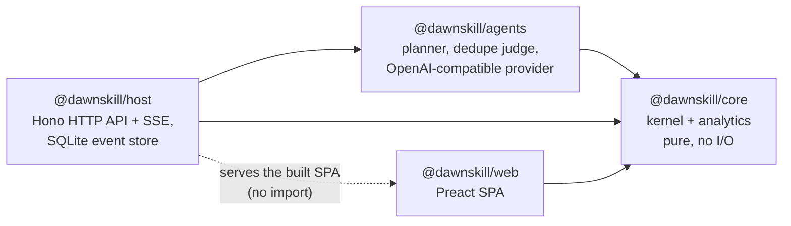

# Architecture

This document describes the code as it is. [PLAN.md](../PLAN.md) holds the original design, and the [last section](#deviations-from-planmd) lists where the code departs from it. Learning-science constants are specified in [learning-model.md](learning-model.md).

## Packages

Arrows point from a package to the packages it imports. The direction is enforced three ways:

- **TypeScript project references.** `packages/core/tsconfig.json` references nothing, `agents` and `web` reference only `core`, and `host` references `core` and `agents`. An import against that direction fails `tsc -b`.
- **oxlint import bans** (`.oxlintrc.json`):
  - `core` may not import `node:*`, `fs`, `net`, `http`, `child_process`, `@earendil-works/*` or any other `@dawnskill/*` package, and may not call `Date.now`, `performance.now`, `Math.random`, `crypto.randomUUID` or `crypto.getRandomValues`. The clock and ids are injected.
  - `node:sqlite` is banned everywhere except `packages/host/src/db/**`.
  - `@dawnskill/core/user` is banned in `agents` and `web`.
- **Runtime layout.** Node runs the server's `.ts` files directly through type stripping. The web package is built by Vite, and the host serves `packages/web/dist` as static files with an SPA fallback.

The web app imports `core` for its types and for the pure helpers it shares with the server: `canTaskTransition`, `validateDraft`, `planLearning` for the approval preview, `rocWeights`, `ACTIVITY_GUIDE` and `LEVEL_NAMES`. The server still makes every decision.

## Kernel

`packages/core/src/kernel/` is the human-owned part (see CODEOWNERS). Every state change goes through `apply(state, event)`.

### Transition tables

`transitions.ts` holds the lifecycles as `as const` data:

| Machine | Transition | From | To |
|---|---|---|---|
| Task | `TaskStarted` | open | doing |
| | `TaskPaused` | doing | open |
| | `TaskCompleted` | open, doing | done |
| | `TaskCancelled` | open, doing | cancelled |
| | `TaskReopened` | done, cancelled | open |
| Proposal | `PlanApproved`, `LevelConfirmed` | pending | accepted |
| | `ProposalRejected` | pending | rejected |
| | `Superseded` | pending | superseded |

The reducer, the generated SQLite triggers, the trigger tests and the web UI (which uses it to decide which buttons to show) all read these tables. `TASK_STATUS_EDGES` and `PROPOSAL_STATUS_EDGES` are the distinct (from, to) pairs.

### Pure reducer

`apply(state, event)` returns `{ ok: true, state }` or `{ ok: false, code, message }`, where `code` is one of `not-found`, `illegal-transition`, `blocked`, `cycle`, `closed-task-edge`, `actor`, `invalid` or `duplicate`. The message names the bad value and the legal set. On `Illegal` the caller keeps the old state.

- `reduce` switches over every event type with no `default` branch. oxlint's `switch-exhaustiveness-check` with `allowDefaultCaseForExhaustiveSwitch: false` makes a missing case a lint error.
- Ids (`G<n>`, `T<n>`, `P<n>`) come from one counter, `state.nextId`, and time comes from `event.at`. Same log in, same state out.
- Unchanged entities keep their object identity. Persistence relies on this: it diffs by identity.
- `readiness.ts` derives `blocked`/`ready`: a task is blocked while it has an open blocker or any skill gap, and an unrated skill counts as a gap. Gaps, priority, estimates and review schedules are computed and never stored. A task's `develops` (skills it builds, `{ skill, level }`) never blocks it.
- `learning.ts` (`planLearning`) turns gaps into learning chains. Each skill gets one task per level step, from the current level + 1 up to the highest level any consumer needs, and each step blocks the next. A skill's first open step waits on the last open step of each of its prerequisites. Each consumer waits on the step that reaches its own required level. Existing non-cancelled steps are reused, so running it again adds nothing. It runs on `PlanApproved` and on `LearningStepsAdded`. It reads only `requirements`: `develops` creates no learning steps.
- `validate.ts` checks drafts, new tasks, task patches and new skills: field ranges, references, acyclic prerequisites and the skill-key pattern. `validateDraft` accepts up to 1000 tasks and 1000 skills (`MAX_DRAFT_TASKS`, `MAX_DRAFT_SKILLS`), enough for a whole curriculum. `develops` entries (draft `develops`, `NewTask`/`TaskPatch` `develops`) must name existing skills once each, at levels 1–5 and above any level the same task requires for that skill; a draft task's `develops` is omitted or non-empty, and a learning task cannot be given one.
- `develops` is stored only when non-empty (`developsField`), so tasks replayed from logs that predate the field keep their canonical JSON and state hash. `TaskEdited` with `develops: []` removes it.

### Events and actors

`EventBody` (`events.ts`) is the union of every event type. Each carries an envelope `{ at, actor }`, where `actor` is `user`, `agent` or `system`.

| Group | Events |
|---|---|
| Tasks | `TaskCreated`, `TaskEdited`, `TaskStarted`, `TaskPaused`, `TaskCompleted`, `TaskCancelled`, `TaskReopened` |
| Dependencies | `DependencyAdded`, `DependencyRemoved`, `LearningStepsAdded` |
| Skills | `SkillCreated`, `SkillSelfRated`, `ReviewRecorded` |
| Proposals | `PlanProposed`, `LevelProposed`, `ProposalRejected`, `PlanApproved`, `LevelConfirmed` |
| Preferences | `PreferencesSet` |

`apply` checks the actor at runtime (`actorDenied`). `agent` may emit only `AGENT_EVENTS` (`PlanProposed`, `LevelProposed`). `system` may emit nothing; system-authored records exist only inside a user event. For example, completing a learning task creates a pending level proposal with actor `system` in the same step. Completing a task with `develops` works the same way: `TaskCompleted` requires a non-empty `outcome`, and creates one pending level proposal (evidence: the outcome and evidence URL, `fromTaskId`) per developed skill whose current level is unrated or below the developed level. `TaskCreated`, `TaskEdited` and `PlanProposed`/`PlanApproved` drafts carry `develops`. The host posts planner output as `PlanProposed` with actor `agent` (`host/src/runs.ts`). The HTTP events route posts everything as `user`.

### Branded user confirmations

`PlanApproved` and `LevelConfirmed` (`USER_CONFIRMATIONS`) only type-check inside a `KernelEvent` when they carry the phantom `UserConfirmed` brand. The only function that applies the brand is `userEvent` in `@dawnskill/core/user`. In the app, only the host's events handler (`host/src/api.ts`) imports that module; the store's replay casts stored events, which were legal when applied. oxlint bans the import in `agents` and `web`. Agent code therefore cannot construct an approval without failing typecheck or lint. The runtime actor check is the second layer.

### Invariants

| ID | Invariant | Reducer | Generated triggers | Tests |
|---|---|---|---|---|
| K1 | A skill level changes only through a user event: a self-rating (`SkillSelfRated`, or ratings in `PlanApproved`) or `LevelConfirmed` of a pending proposal | `skillSelfRated`, `planApproved`, `levelConfirmed`; `actorDenied` | `skill_insert_unrated`, `skill_level_needs_assessment` (the level must equal the latest assessment row) | model-based `checkLevels`; trigger tests; oracle `levelDiffersFromLatestAssessment` |
| K2 | A task closes only with a completion row written in the same step (done *and* cancelled) | `taskCompleted`, `taskCancelled` | `task_close_needs_completion`, `task_status_transition` | `checkCompletions`; trigger tests; oracle `closedWithoutMatchingCompletion` |
| K3 | A derived-blocked task (open blocker or skill gap) cannot enter `doing` | `taskStarted` → `isBlocked` | none (blocked is derived, not stored) | `checkGraph`; HTTP and Docker smoke: starting a blocked task returns 409 |
| K4 | The dependency graph stays acyclic; no edge is added to or removed from a closed task | `dependencyAdded` (`wouldCycle`, `closedEdgeEnd`), `dependencyRemoved`, `planLearning` | `dependency_insert_open_tasks`, `dependency_delete_open_tasks` (closed tasks only; acyclicity is not a trigger) | `checkGraph`; learning properties; oracle `dependencyCycle` |
| K5 | Only a pending plan commits, re-validated against the current state; a superseded or rejected plan never commits | `planApproved`, `planProposed` (`supersedes`) | `proposal_status_transition` | `checkProposals`; oracle `acceptedWithoutPending`; host scenarios "plan superseded" |
| K6 | Agent events only create pending proposals | `actorDenied` + `AGENT_EVENTS`; `UserConfirmed` brand | none | `checkProposals`; host scenario "agent output only ever becomes a pending proposal" |
| K7 | Closing a task never deletes its edges, so reopening restores blocking | status changes leave `blockers` untouched | `dependency_delete_open_tasks` | `checkGraph`; trigger and store tests |
| K8 | Replaying `kernel_events` from empty reproduces the stored state | determinism of `apply` | — | store property "close and reopen…"; tampered-hash test |

## Persistence

`packages/host/src/db/` (also human-owned) holds the only code that opens SQLite.

- **The event log is the source of truth.** `kernel_events(seq, at, actor, type, body, state_hash)` is append-only, and `state_hash` is the sha256 of the canonical JSON of the state after that event.
- **One writer.** `Store.apply` runs `core.apply`. If the result is legal, a single `BEGIN IMMEDIATE` transaction writes the changed projection rows and the event row. Only after the commit does it update the in-memory state and notify subscribers (SSE). A rejected event writes nothing.
- **Projection tables:** `proposals`, `goals`, `skills`, `skill_prerequisites`, `assessments`, `tasks`, `task_requirements`, `task_develops`, `dependencies`, `completions`, `reviews`, `preferences`, plus `allowed_transitions`. `projectionWriter` writes only the entities whose reference changed, in an order that keeps foreign keys and triggers satisfied. The app never reads the projection back: it exists for the triggers, the oracles and external SQL inspection.
- **Replay on open.** `openStore` replays the whole log through `core.apply`. It fails if an event is now illegal, if a sequence number disagrees, or if the final state hash differs from the stored one ("the log or the kernel changed").
- **Migrations.** These are append-only SQL strings in `schema.ts` (`MIGRATIONS`), tracked by `PRAGMA user_version`. Migration 1 creates the base schema; migration 2 adds `task_develops(task_id, skill, level 1–5, PRIMARY KEY (task_id, skill))`. A database newer than the build is refused. Connections run with WAL, `synchronous = NORMAL`, `foreign_keys = ON` and `busy_timeout = 5000`.
- **Generated triggers.** `triggers.ts` (`generateTriggerSql`) builds `generated-triggers.sql` from `TASK_STATUS_EDGES` and `PROPOSAL_STATUS_EDGES`: it fills `allowed_transitions` and creates `BEFORE` triggers that `RAISE(ABORT)`. A `CHECK` constraint cannot do this because SQLite forbids subqueries in `CHECK`. The file is committed. `pnpm triggers:gen` rewrites it, and `pnpm triggers:check` (part of `pnpm check` and CI) prints a line diff and exits 1 on drift. Every database open drops and reinstalls the triggers, so an existing database picks up changed tables.

## Planner

`packages/agents` turns a goal into a `PlanDraft` (`planGoal`) through the `ChatProvider` interface (`completeJson(request, signal, onDelta) → raw JSON text`; `onDelta` hears each streamed chunk `{ reasoning, content }`). `PlannerInput` is `{ goal, context, sources, uncapped }`: `sources` are pages the host already fetched (`{ url, title, text }`), and `uncapped` lifts the task cap so a supplied curriculum is planned in full. `planGoal`'s `onStream` option reports a `request` event (`stage`: `extract`, `tasks`, `skills` or `dedupe`) before every model request, repairs included, and a `delta` event per chunk.

1. **Extraction** (`plan_extract` schema), only with sources, and in uncapped mode also on a non-empty context (source `context`). Each source text is cut into chunks of at most 8000 characters at heading and blank-line boundaries (a chunk starting inside a section is prefixed with its heading), one request per chunk. The model lists every study resource the page recommends, in page order: `{ section, title, creator, kind, level, note }`, companion material (solution manuals, other editions) in the note of the item it accompanies. Items are merged across chunks and sources by title + creator, ignoring case, spacing, punctuation and diacritics; the first occurrence and its source stay. No items: planning continues without a curriculum.
2. **Stage A, tasks** (`plan_tasks` schema, built per request by `tasksSchema`). The prompt covers software and study goals: every task is a concrete action on a named resource or a concrete product, never planning work handed back to the user (collecting or ordering sources, drafting a curriculum or schedule, building trackers), never category `learning`. `after` holds 0-based indices of earlier tasks. Normalization rounds minutes and drops forward, self and out-of-range indices, so the dependencies always form a DAG. The goal text is the user's, trimmed and cut to 200 characters; the model never rewrites it. Capped (default): one request, 3–12 tasks (`MAX_TASKS`) of at most 480 minutes (`MAX_TASK_MINUTES`); with a curriculum the tasks work through it from its first item and the summary names the covered part. Uncapped with a curriculum: one request per 8 items (`ITEMS_PER_REQUEST`), each listing its items and the titles of the tasks planned so far (global indices); every task names its `item` (an `enum` of the request's item numbers), every item needs at least one task (at most `TASKS_PER_ITEM` = 3); estimates may reach 100000 minutes (`MAX_UNCAPPED_TASK_MINUTES`, a whole resource with its exercises). The first request writes the summary. Uncapped without a curriculum: one request with no task cap.
3. **Stage B, skills** (`plan_skills` schema, built per request by `skillsSchema(taskIndices, maxSkills)`). The model lists skills with `neededBy: [{ task, level }]` (external prerequisites the plan does not teach) and `developedBy: [{ task, level }]` (study and practice tasks that build the skill, with the level they bring the user to); a skill with both empty links to nothing and is dropped (with prerequisite references to it), but a reply in which no skill has a link is repaired. `task` is an `enum` of the request's task indices and `level` an `enum` of 1–5, so constrained decoding cannot produce a dangling reference. `requires` is derived from `neededBy`, `develops` from `developedBy` (left out when empty), taking the highest level per task and skill. An entry whose key exactly matches a known skill reuses that skill. Unknown prerequisite keys are dropped. Capped plans ask once (at most 30 skills); uncapped plans ask per 8 tasks, listing the skills defined so far so later requests reuse their keys, and merge by key (first definition's fields, links united).
4. **Validation and bounded repair.** Each request's output is normalized (keys slugified, strings trimmed, duplicates and non-http(s) resources dropped), checked against its JSON Schema and against core `validateDraft`, and then either accepted or answered with a repair turn. The repair turn repeats the original request, then quotes the output and numbers every error. Each request gets at most `maxRepairs` repairs (default 2). After that `PlannerError` carries the errors and the attempt count.
5. **Truncation.** A reply ending with `finish_reason: "length"` raises `TruncatedReplyError`. If no answer content arrived before the cut (`thinkingOnly`: a reasoning model spent the whole reply budget thinking), halving or shorter retries cannot help, but runaway thinking is stochastic: the identical request is sent once more, outside the repair budget, and a second thinking-only cut fails the run at once with a message to raise Max reply tokens. Otherwise an extraction chunk, an uncapped item batch or an uncapped skills batch is split in half and each half requested on its own; anything else is sent again with a note asking for a shorter reply (capped plans: at most 8 items, one sentence per field). Both use the request's repair budget. A context-size error from the server (`ContextSizeError`) is fatal and not retried.
6. **Dedupe judge.** For each new draft skill, existing skills whose key+name token Jaccard is ≥ 0.5 are candidates, judged best match first, with at most 8 judge calls per plan. Each judge call asks for `{"same": boolean}` (schema `same_skill`). Anything other than an explicit `true` keeps the new skill. A merge is applied only if the draft stays valid; it renames the skill in `requires` and `develops` alike.

`openAiCompatibleProvider` POSTs to `<base>/chat/completions` with `stream: true`, `temperature: 0.2`, `max_tokens` capped at the configured `maxTokens` (Max reply tokens saved in Settings, else `DAWNSKILL_LLM_MAX_TOKENS`; planner stages ask for no smaller budget, so they get all of it, while the dedupe judge asks for a few tokens) and `response_format.type = "json_schema"` with `strict: true`. It reads the SSE chunks, passing the model's thinking (`delta.reasoning_content` from llama.cpp/DeepSeek/vLLM, `delta.reasoning` from OpenRouter/Ollama) and the answer text to `onDelta`, and falls back to a plain JSON body when the server ignores streaming. It applies a timeout per try (Timeout saved in Settings, else `DAWNSKILL_LLM_TIMEOUT_MS`) and redacts the API key from errors. When a server refuses `json_schema` with HTTP 400 (`RESPONSE_FORMAT_ERROR`, e.g. OpenCode Go's "This response_format type is unavailable now", about 1 in 6 requests on `deepseek-v4.1-flash`, in clusters), that request is resent at once, without using a retry, with `response_format: { type: "json_object" }` and the JSON Schema appended to the system message; the planner's schema check and repair turns keep the reply correct. The next request tries `json_schema` again. Transient failures before the reply body is read are tried up to 3 times, waiting 2 s then 6 s (a cancel during the wait rejects at once): network errors, HTTP 408/429/500/502/503/504, and HTTP 400 whose body reads like a gateway hiccup (`TRANSIENT_ERROR`: "upstream request failed", "overloaded", "try again", …). Context-size errors, timeouts, other 4xx and failures after streaming began are not retried; the last error is reported.

The host queues planner runs and executes them one at a time, oldest first, in the background (`runs.ts`), so a new goal can be submitted while another is still being planned and a single model is never asked twice at once. At most 10 runs are queued or running at a time. The run's result becomes a `PlanProposed` event with actor `agent`. Run records (`R<n>`, the last 20, `queued` → `running` → `done`/`failed`, or `cancelled` from either of the first two) are kept in memory and published over SSE. Cancelling a queued run drops it from the queue; cancelling the running run marks it `cancelled` at once and aborts its model request, and the next queued run starts once that request has unwound. A cancelled run never proposes, even if the model answers after the abort. Shutdown cancels every queued and running run.
While the model streams, the run's `progress` tracks the current stage, the number of requests, the tail of the current request's thinking (4000 chars) and answer (2000 chars), chunk counts and a tokens-per-second figure. A chunk is roughly one token, so the rate is (chunks − 1) per second between the request's first and last chunk. Progress is published on every new request, on a request's first chunk and then at most every 250 ms; it never fires a `run` event. The finished run keeps the last progress, including chunks the throttle held back; a cancelled run keeps the progress published before the cancel.

The model connection lives in `host/src/llm.ts` (`createLlm`). Settings saved from the web UI (`PUT /api/settings/llm`) are written atomically to `$DATA_DIR/llm-settings.json` with mode 0600 and take precedence over the `DAWNSKILL_LLM_*` environment. That includes the reply budget (`maxTokens`) and request timeout (`timeoutMs`) when they are saved; settings saved without them, including files written before they existed, use `DAWNSKILL_LLM_MAX_TOKENS` and `DAWNSKILL_LLM_TIMEOUT_MS` or their defaults (4096, 120000). The web form always saves both, and the OpenCode Go and OpenRouter presets fill 32768 tokens and 300 s because hosted models reason before they answer. They are not events, so the key never enters the log or an export. Each plan run connects a new provider from the current settings when it is queued, so a saved change applies to runs queued after it, and a queued or running run keeps the provider it was queued with. A provider is one conversation: all its requests carry the same `x-opencode-session` ID, which OpenCode Go requires for routing and prompt caching. A saved key is reused only for the URL it was entered for, so changing `baseUrl` without a new `apiKey` is refused: whoever can reach the API cannot redirect the key to a server of their choosing. An unreadable settings file stops startup with its path.

### Sources

`host/src/sources.ts` reads the pages named in a plan request. `POST /api/plan` merges the request's `sources` with the http(s) links `findUrls` finds in the goal and context (in order of first appearance, trailing sentence punctuation stripped, no repeats), listed ones first, and refuses more than 10 (`MAX_SOURCES`). The run reads them one at a time before the first model request (`fetchSources`), publishing progress with stage `fetch` and the page's URL as `output`; a cancelled run reads no further page and never reaches the model.

- **Limits.** 30 s per page (response and body), at most 5 MB of body read (the rest of the stream is cancelled), at most 200 000 characters of text kept. Only `text/html`, `application/xhtml+xml` and `text/plain` are read; the body is decoded with the declared charset.
- **HTML.** linkedom parses the page (adding the `<body>` a hand-written page may omit) and `@mozilla/readability` picks the article, with `linkDensityModifier: 1` so link-dense book lists are not dropped as navigation. The article is reduced to markdown-like text (headings, list items as `- `, paragraphs separated by blank lines; scripts, navigation, forms and images skipped). If Readability finds nothing, the whole `<body>` is reduced instead. The title is Readability's, else `<title>`, else the URL.
- **Errors.** Nothing is retried. The first unreadable page rejects with `SourceError` (`could not read <url>: <reason>`: not http(s), `HTTP <status>`, unsupported content type, no answer within the timeout, no readable text, or the network error), which fails the run with that message and 0 attempts. A cancel rejects with the abort reason instead.

## HTTP API

Routes are mounted by `createApp` (`host/src/server.ts`) and `createApi` (`host/src/api.ts`). Request bodies are limited to 1 MiB (413 `{ error }` when larger). Unknown `/api/*` paths return 404 `{ "error": "not_found" }`. An unhandled error returns 500 `{ "error": "internal error" }`.

| Method & path | Request | Success | Errors |
|---|---|---|---|
| `GET /healthz` | — | 200 `{ ok: true, version }` | — |
| `GET /api/view` | optional `If-None-Match` | 200 `View`, `ETag: "<seq>-<ms>"`, `Cache-Control: no-cache`; 304 when the ETag matches | — |
| `POST /api/events` | `EventBody` JSON (`{ "type": "TaskStarted", "taskId": "T3" }`) | 200 `{ seq }` | 400 `{ error, details[] }` (malformed JSON, unknown type, schema violation; details are JSON-pointer messages); 409 `{ code, message }` (kernel `Illegal`) |
| `POST /api/plan` | `{ goal (1–500 chars), context? (≤ 4000), supersedes?, sources? (≤ 10 http(s) URLs), uncapped? (boolean) }`; links in `goal` and `context` are added to `sources` (see Sources) | 202 `{ runId }`; the run is queued behind earlier runs | 400 `{ error, details[] }` (schema violation, or more than 10 URLs once goal and context links are added); 409 `{ code: "invalid" }` if `supersedes` is not a pending plan; 409 `{ code: "busy" }` while 10 runs are queued or running; 503 `{ error }` without a model |
| `GET /api/plan/runs` | — | 200 `PlanRun[]`, newest first | — |
| `POST /api/plan/runs/:id/cancel` | — | 200 `PlanRun` (status `cancelled`) | 404 `{ error }` for an unknown run; 409 `{ code: "finished" }` once the run is done, failed or cancelled |
| `GET /api/stream` | — | Server-sent events: `change` `{ seq }` (sent once on connect and after every committed event), `run` `PlanRun` on every run status change, `progress` `{ id, progress: RunProgress }` while a run's model streams (see Planner); a `: ping` comment every 25 s | — |
| `GET /api/export` | — | 200 `{ format: "dawnskill-events", version, exportedAt, events: [{ seq, at, actor, body, stateHash }] }`, as an attachment | — |
| `GET /api/config` | — | 200 `{ version, llm: LlmStatus }` | — |
| `PUT /api/settings/llm` | `{ baseUrl (http(s) URL), model? (blank: "default"), apiKey?, maxTokens? (integer 256–262144), timeoutMs? (integer 1000–3600000) }`; `apiKey` omitted keeps the saved key, null or blank removes it; `maxTokens`/`timeoutMs` omitted use the environment's or the default | 200 `{ llm: LlmStatus }` | 400 `{ error, details[] }` (schema violation including `maxTokens`/`timeoutMs` out of range, URL not http(s), `apiKey` missing while `baseUrl` changes away from a saved key) |
| `DELETE /api/settings/llm` | — | 200 `{ llm: LlmStatus }`; the environment's configuration, if any, applies again | — |
| `GET /*` | — | static files from `WEB_DIR`, otherwise `index.html` (SPA fallback) | 404 text when the UI is not built |

`View` (`core/src/analytics/view.ts`) is `{ seq, now, criteriaRank, weights, goals, tasks, skills, proposals, focus, journal, reviews, categories }`. `deriveView(state, now)` computes it. The API caches it per `seq` and recomputes after 60 s even without new events, so ages and due reviews move forward with time.

`PlanRun` is `{ id, goal, sources[], uncapped, status: "queued" | "running" | "done" | "failed" | "cancelled", attempts, error, errors[], proposalId, queuedAt, startedAt, finishedAt, progress: RunProgress | null }`; `sources` lists the pages the run reads (the request's, then the goal and context links) and `uncapped` whether it plans without a task cap. `RunProgress` is `{ stage: "fetch" | "extract" | "tasks" | "skills" | "dedupe", requests, reasoning, output, tokens, totalTokens, tokensPerSecond: number | null }`; while a page is read, `stage` is `fetch`, `output` holds its URL and the counters are 0. `progress` is null until the first page read or model request.

`LlmStatus` is `{ configured, source: "app" | "env" | null, model, baseUrl, hasApiKey, maxTokens, timeoutMs }`. It never contains the key, and `baseUrl` is set only for settings saved in the app. `maxTokens` and `timeoutMs` are the effective limits: the saved ones, else the environment's or the default.

Request bodies are checked with TypeBox (`host/src/schemas.ts`): one closed schema per event variant, with structural size caps only. Every semantic rule stays in the kernel.

## Testing strategy

All tests run under Vitest (`pnpm test`, one project per package) and are deterministic:

- Clocks are injected (the core never reads time) and `TZ=UTC`.
- There is no network and no live model.
- fast-check uses a global seed from `FC_SEED` (default 424242) and `FC_NUM_RUNS` (default 200) set in `test/setup.ts`.

| Kind | What it proves | Where |
|---|---|---|
| Model-based properties | Random sequences of 10–40 events, user and forged agent/system ones, keep K1–K7, and illegal events are rejected; `checkDevelops`: `develops` is absent or well-formed, and closing a learning or developing task proposes exactly the targets the skill has not reached | `core/src/kernel/apply.test.ts` |
| Kernel properties | Learning chains (one step per level, reuse, idempotence, no cycles, no edges on closed tasks); draft validation rejects every listed violation, including malformed `develops` (empty, unknown or duplicate skill, level 0 or 6, not above the required level); ROC weights, scores, estimates, review intervals, and reviews starting from a done task that develops a skill | `learning.test.ts`, `validate.test.ts`, `analytics.test.ts` |
| SQL invariant oracles | After every step of random store scenarios, queries that must return zero rows do (closed task without a matching completion, dangling edge, level ≠ latest assessment, cycle via recursive CTE, accepted without a pending decision), and the projection mirrors the state | `host/src/db/store.test.ts` |
| Trigger tests | Every status pair is accepted by the database exactly when it is in the transition table. The cases are generated from the tables, plus the completion, assessment and closed-edge rules and raw SQL that bypasses the kernel | `store.test.ts` |
| Replay (K8) | Close and reopen reproduces a deep-equal state with matching hashes; a tampered log is refused | `store.test.ts` |
| Scripted provider | Planner stages, repairs, truncation retry, context errors, normalization and skill reuse, run against `scriptedProvider`, which fails on an unexpected call and whose `assertDone()` fails if a reply was left unused. "skill links": `develops` derived from `developedBy`. "curriculum planning": an uncapped curriculum planned in item batches, a capped curriculum in one request of at most 12, an uncapped goal without a curriculum, splitting a truncated extraction chunk and a truncated task batch, repairing a batch that leaves an item without a task | `agents/src/planner.test.ts`, `agents/src/testing.ts` |
| Page reading | `fetchSources` against a stub `fetch`: HTML reduced to headings, list items and paragraphs without chrome; a link-dense reading list kept; plain text with its charset; request order and failure on the first unreadable page; non-http(s) links, unsupported content types and pages with no readable text refused; endless bodies stopped and text capped; abort reason passed through; timeout as `SourceError`. `findUrls` order, punctuation and repeats | `host/src/sources.test.ts` |
| Host scenarios | HTTP flows over `createApp` with an in-memory store and the scripted provider: goal intake, approval required, plan superseded, plan queue (FIFO, one run at a time, full queue, cancelling a queued or running run, a cancelled run never proposing, cancel 404/409, shutdown), 400/409 shapes, planner failure, source pages (a page linked in the context reaches the planner, listed pages first then goal and context links, more than 10 refused, an unreadable page fails the run without a model call, cancelling during a page read), whole-curriculum plans (uncapped past the usual task cap; 150 study tasks that develop skills approved without learning steps), ETag caching, no model, model settings (planning enabled without environment, persistence and precedence over the environment, key kept only for its URL, saved reply budget and timeout overriding the environment's and reaching the run's provider, out-of-range limits refused, an older settings file without them loading with the environment's) | `host/src/api.test.ts` |
| Nightly seeds | Daily run with `FC_SEED` = the workflow run id and `FC_NUM_RUNS=2000`. The seed and a replay command are printed to the job summary | `.github/workflows/nightly.yml` |
| Mutation testing | Weekly Stryker run over `packages/core/src` (incremental; report uploaded as an artifact). Baseline 2026-10-16: 70.7% overall (validate 85%, mcda 80%, learning 77%, apply 72%, view 36%). `vitest.mutation.config.ts` rewrites the runner's test-name filter for vitest 5's `" > "` separator; without it every mutant runs zero tests and "survives" | `stryker.config.json`, `vitest.mutation.config.ts`, `pnpm mutation` |
| Docker smoke | Built image: health, SPA, the offline plan → approve → learning-steps flow, the blocked start returning 409, persistence across a restart, export, non-root user | `scripts/docker-smoke.sh`, CI `docker` job |

Performance is measured separately with `pnpm perf`. The results and budgets are in [performance.md](performance.md).

## Deviations from PLAN.md

- **Pi Durable is not used.** A planner run is a sequence of short requests: extraction per source chunk, the task and skill stages (batched for uncapped curricula), bounded repairs and judge calls, with no long-lived agent state to resume. Durability comes from the event log in our own SQLite file: a run either commits a `PlanProposed` event or leaves nothing behind. Pi Durable 1.3 is experimental, with breaking changes in minor releases. It can be added later behind the `ChatProvider` interface without touching the kernel. As a result the `pi_*` tables and the per-user harness pool do not exist, and tests use our own `scriptedProvider` instead of Pi's faux provider.
- **The Quint model is not written yet.** K1, K5 and K6 are covered by the reducer, the brand and lint rules, model-based tests and host scenarios. There is no `quint verify` step or MBT trace replay.
- **dependency-cruiser and ast-grep are replaced.** TypeScript project references and oxlint import bans enforce the layering. The generated triggers enforce the "no raw `UPDATE … SET status/level` outside the writer" rule at the database: they reject illegal status edges, closing without a completion row, and level changes without a matching assessment, whatever SQL issues them.
- **MCP and authentication are out of scope** (PLAN.md Phases 2–3). The server is single-user and binds to `127.0.0.1` by default. compose.yaml and the documented `docker run` publish only on localhost.
- **Other differences:**
  - The planner and the skill dedupe judge are the only agents; there is no assessor, curator or weekly review.
  - Level proposals come from completed learning tasks (actor `system`). No agent emits `LevelProposed` yet, although the kernel accepts it from agents.
  - Live updates use SSE instead of WebSocket.
  - The host package is `host`, not `host-node`.
  - There is one SQLite file per deployment, with no Litestream.
  - CI does not run `pnpm audit` or osv-scanner.
  - K2 also covers cancellation: closing as `cancelled` writes a completion row too.
  - A plan proposal goes `pending → accepted` in a single step, with no separate "committed" state.
